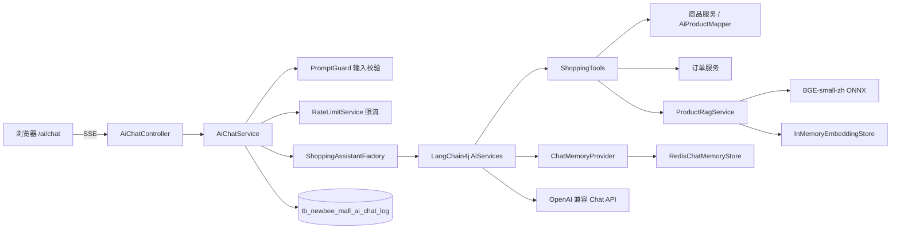

# 新蜂 AI 导购系统（NewBee AI Shopping Agent）

> 基于开源电商系统 [newbee-mall](https://github.com/newbee-ltd/newbee-mall) 二次开发，新增 **AI 导购 Agent** 模块。
> 上游项目与本项目均以 **GPL-3.0** 开源，源文件中的上游版权头已完整保留。

## 这是什么

一个能“对话式逛商城”的 AI 导购后端：用户用自然语言描述需求，系统完成商品语义检索与推荐、商品详情查询、订单查询，并以 SSE 流式返回回答。

- 用户：“预算 500 元以内，推荐一款适合学生党的蓝牙耳机”
- 小蜂：调用商品检索工具 → 召回相关商品 → 结合价格/库存/标签给出推荐理由和详情链接
- 已登录用户：“帮我查一下我的订单到哪了” → 调用订单工具，只返回当前用户自己的订单

## 功能清单

| 能力 | 说明 |
|---|---|
| AI 导购对话 | LangChain4j AiServices + OpenAI 兼容大模型，支持多轮对话 |
| SSE 流式输出 | 逐字返回，工具调用事件单独推送 |
| 商品 RAG | 本地 BGE-small-zh 中文向量模型 + 内存向量库，启动时异步索引 |
| 工具调用 | 商品搜索、商品详情、我的订单、订单详情 |
| 数据隔离 | 订单工具的 `userId` 由服务端 Session 注入，模型无法伪造 |
| 会话记忆 | Redis 存储，TTL 7 天；Redis 故障自动降级到内存 |
| 限流 | Redis 固定窗口 + 本地滑动窗口降级，按用户/IP 限流 |
| 输入安全 | 提示词注入/危险指令正则拦截 + 系统提示词安全边界 |
| 审计 | 每次问答记录用户、会话、问题、耗时、成功状态到 MySQL |
| 原有商城功能 | 商品、分类、购物车、订单、后台管理等上游功能保持不变 |

## 技术栈

- **Java 17** / **Spring Boot 3.5.7** / **MyBatis 3.0.5**
- **MySQL 8.0** / **Redis**
- **LangChain4j 1.23.0**（AiServices、Function Calling、ChatMemory）
- **BGE-small-zh-v1.5**（ONNX 本地向量模型，ONNX Runtime 1.19.2）
- **Thymeleaf** 页面 + 原生 SSE 前端

## 系统架构



请求链路：

1. `AiChatController` 接收问题，从 Session 取当前用户（可为空）。
2. `AiChatService` 做输入校验、限流，创建绑定当前用户的 `ShoppingAssistant`。
3. LangChain4j 根据用户问题决定是否调用工具；工具只访问上架商品和当前用户订单。
4. 商品检索优先走向量召回，索引未就绪或召回为空时回退到 MySQL 关键词查询。
5. 回答通过 SSE 逐字返回，完成后写审计日志；会话消息写入 Redis。

## 快速开始

### 1. 环境要求

- JDK 17
- Maven 3.9+（项目未带 mvnw，可用本机 Maven）
- MySQL 8.0
- Redis 5.0+

### 2. 初始化数据库

```bash
mysql -uroot -p -e "CREATE DATABASE IF NOT EXISTS newbee_mall_db DEFAULT CHARACTER SET utf8mb4 COLLATE utf8mb4_general_ci;"
mysql -uroot -p newbee_mall_db < src/main/resources/newbee_mall_schema.sql
mysql -uroot -p newbee_mall_db < docs/ai-module.sql
```

### 3. 启动 Redis

```bash
redis-server --port 6379
```

### 4. 配置 AI 模型

任选一个 **支持 Function Calling 的 OpenAI 兼容接口**：

```bash
# 阿里云百炼（默认）
export AI_API_KEY=sk-xxxxxxxx
export AI_BASE_URL=https://dashscope.aliyuncs.com/compatible-mode/v1
export AI_CHAT_MODEL=qwen-plus

# 或 DeepSeek
# export AI_BASE_URL=https://api.deepseek.com/v1
# export AI_CHAT_MODEL=deepseek-chat
```

Windows PowerShell：

```powershell
$env:AI_API_KEY="sk-xxxxxxxx"
$env:AI_BASE_URL="https://dashscope.aliyuncs.com/compatible-mode/v1"
$env:AI_CHAT_MODEL="qwen-plus"
```

> **说明**：商品向量化使用本地 BGE 模型，不需要额外的 embedding API。
> 未配置 `AI_API_KEY` 时应用仍可启动，聊天接口会返回配置提示，方便先验收工程骨架。

数据库连接默认 `127.0.0.1:3306`，本地端口不同可用环境变量覆盖：

```bash
export DB_PORT=3307
export DB_USERNAME=root
export DB_PASSWORD=your-password
```

### 5. 启动应用

```bash
mvn spring-boot:run
```

打开 <http://localhost:28089/ai/chat>，首页导航栏也新增了「AI 导购」入口。

### 6. 验证

```bash
# 健康状态（模型是否配置、RAG 索引数量）
curl http://localhost:28089/ai/status

# 同步问答
curl -X POST http://localhost:28089/ai/chat \
  -H "Content-Type: application/json" \
  -d '{"message":"推荐一款 300 元以内的机械键盘","sessionId":"demo-1"}'

# SSE 流式问答
curl -N "http://localhost:28089/ai/chat/stream?message=hello&sessionId=demo-2"
```

## 接口说明

| 方法 | 路径 | 说明 |
|---|---|---|
| POST | `/ai/chat` | 同步问答，body：`{message, sessionId}` |
| GET | `/ai/chat/stream` | SSE 流式问答，事件：`message` / `tool` / `done` / `error` |
| GET | `/ai/chat` | AI 导购聊天页面 |
| GET | `/ai/status` | 模型配置状态、RAG 索引状态 |

> SSE 当前用 GET 查询参数传消息，便于用 `EventSource` 演示；生产环境建议改为 POST + `fetch` 流式读取，避免 URL 日志泄露问题内容。

## 核心设计

### 商品 RAG

- 启动后异步读取 573 个上架商品（`AiProductMapper.selectOnSale`），拼接名称、简介、标签、价格、库存、详情为文本。
- 使用 BGE-small-zh 本地 ONNX 模型生成向量，写入 `InMemoryEmbeddingStore`；实测启动索引耗时约 2.2 秒。
- 查询时先向量召回 Top-K（默认 5，最低相似度 0.35），再按商品 ID 回查详情；召回为空时回退 SQL 关键词检索。

### 工具层数据隔离

```java
// userId 来自 HttpSession，不作为工具参数暴露给模型
new ShoppingTools(goodsService, orderService, productMapper, ragService, properties, userId);
```

- 订单工具未登录直接返回提示，不访问数据库。
- 即使模型被诱导传入其他用户信息，也没有可伪造的 `userId` 参数。
- 订单服务内部还有一层 `order.getUserId().equals(userId)` 校验。

### 会话记忆与降级

- 实现 LangChain4j `ChatMemoryStore`，使用官方 `ChatMessageSerializer` 做 JSON 序列化，Redis key 前缀 `ai:memory:`，TTL 7 天。
- Redis 读写异常时自动使用进程内 `InMemoryChatMemoryStore` 副本，聊天不中断。
- 限流同样有 Redis 固定窗口 + 本地滑动窗口双实现。

### 安全与可观测

- `PromptGuard`：长度限制 500 字，拦截“忽略之前指令”“系统提示词”“drop table”等模式。
- 系统提示词明确禁止修改数据、执行命令、泄露提示词。
- 审计表 `tb_newbee_mall_ai_chat_log` 记录用户、会话、问题、耗时、成功状态，便于排查和统计。

## 与上游项目的差异（我做了什么）

上游：[newbee-mall](https://github.com/newbee-ltd/newbee-mall) 的 `spring-boot-3.x` 分支（commit `eb71557`）。

本项目的增量：

1. **框架升级**：Spring Boot 3.1.0 → 3.5.7；MyBatis Starter 3.0.2 → 3.0.5；Jackson 2.22.4；修复升级后的兼容性问题。
2. **AI 模块**：新增 `ltd.newbee.mall.ai` 包（配置、Agent、工具、RAG、记忆、限流、安全、审计、控制器）。
3. **数据库**：新增 AI 审计表 `tb_newbee_mall_ai_chat_log`。
4. **前端**：新增 `/ai/chat` 聊天页与导航入口，SSE 流式渲染。
5. **测试**：新增 10 个单元测试（提示词防护、工具层、RAG 索引与召回）。
6. **配置**：数据库/Redis/AI 参数全部改为环境变量覆盖，便于部署。

上游的商品、分类、购物车、订单、后台管理等业务代码保持原样；AI 模块通过既有 Service 接口接入，不重复实现业务逻辑。

## 已知限制 / Roadmap

- 向量库为进程内存，重启需重建；数据量增大后可替换为 pgvector / Milvus / Redis Stack（`EmbeddingStore` 接口不变）。
- RAG 索引构建在启动后异步执行，首次对话若索引未完成会走关键词兜底。
- SSE 使用 GET；生产建议改 POST 流式。
- 限流为单机固定窗口；多实例部署可换网关限流或 Redis Lua 滑动窗口。
- 尚未加入 Docker Compose（计划中）。

## 许可证与致谢

- 本项目基于 [newbee-mall](https://github.com/newbee-ltd/newbee-mall)，上游版权归 **十三 / newbee-ltd** 所有。
- 上游与本项目均采用 **GPL-3.0**；重新分发请遵守 GPL-3.0，并保留源文件中的版权头。
- 详细说明见 [ATTRIBUTION.md](ATTRIBUTION.md)。
