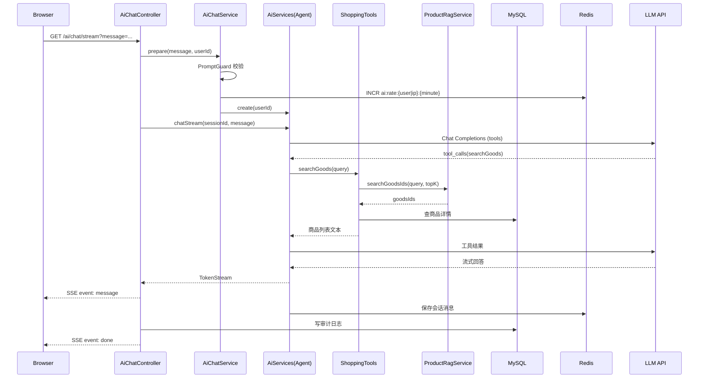

# 架构设计说明

## 1. 模块划分

```
ltd.newbee.mall
├── ai
│   ├── agent        # ShoppingAssistant 接口 + 按用户创建 Agent 的工厂
│   ├── config       # LangChain4j / AI 参数配置
│   ├── controller   # 聊天 REST/SSE 接口与聊天页
│   ├── entity       # AI 审计日志实体
│   ├── memory       # Redis ChatMemoryStore（含内存降级）
│   ├── rag          # 商品向量索引与召回
│   ├── service      # 编排、校验、限流、审计
│   └── tools        # 商品/订单工具
├── controller       # 上游商城控制器
├── service          # 上游业务服务（AI 工具复用）
├── dao              # MyBatis Mapper（新增 AiProductMapper / AiChatLogMapper）
└── ...
```

## 2. 一次对话的时序



## 3. RAG 设计

### 3.1 文档构建

每个上架商品拼接以下字段：

```
商品ID: 1
商品名称: ...
商品简介: ...
标签: ...
价格: ... 元
库存: ...
分类ID: ...
详情: ...
```

元数据写入 `goodsId`，检索后可直接回查数据库，避免把价格/库存缓存到向量库造成不一致。

### 3.2 索引

- 使用 BGE-small-zh-v1.5 本地 ONNX 模型（512 维）。
- `ApplicationReadyEvent` 后启动守护线程异步构建，避免阻塞应用启动。
- 分批 `embedAll`（默认 50 条/批），写入 `InMemoryEmbeddingStore`。
- 575 个商品实测索引约 2.2 秒。

### 3.3 检索

```java
EmbeddingSearchRequest.builder()
    .queryEmbedding(queryEmbedding)
    .maxResults(topK)        // 默认 5
    .minScore(0.35)          // 过滤低相关
    .build();
```

索引未就绪或命中为空时，`ShoppingTools` 回退到 `AiProductMapper.selectOnSale(keyword, limit)`，保证聊天可用。

### 3.4 为什么用内存向量库

- 商品量级小（573 条），内存检索毫秒级；
- 无额外基础设施依赖，方便演示；
- `EmbeddingStore` 是接口，后续可无痛替换 pgvector / Milvus / Redis Stack。

## 4. 工具层安全

```java
public class ShoppingTools {
    private final Long userId; // 来自 HttpSession，不是模型参数

    @Tool("查询当前登录用户的最近5条订单...")
    public String getMyOrders() {
        if (userId == null) return "当前用户未登录...";
        // 只按 userId 查询
    }
}
```

- 模型只能选择“调用哪个工具、传什么业务参数”，不能指定 `userId`。
- 订单服务内部还有 `order.getUserId().equals(userId)` 二次校验。
- 商品工具只查 `goods_sell_status = 0` 的上架商品。

## 5. 会话记忆

```java
public class RedisChatMemoryStore implements ChatMemoryStore {
    // getMessages / updateMessages / deleteMessages
    // Redis 异常时自动回退 InMemoryChatMemoryStore
}
```

- Key：`ai:memory:{sessionId}`
- 序列化：LangChain4j `ChatMessageSerializer`（JSON）
- TTL：7 天
- 每个会话保留最近 20 条消息（`MessageWindowChatMemory`）

## 6. 限流与降级

```text
请求 -> Redis INCR ai:rate:{clientKey}:{minute}
     -> 首次设置 65s 过期
     -> 超过阈值返回“请求太频繁”
     -> Redis 异常 -> 本地滑动窗口
```

`clientKey`：登录用户 `u:{userId}`，匿名用户 `ip:{remoteAddr}`。

## 7. 审计

表 `tb_newbee_mall_ai_chat_log`：

| 字段 | 说明 |
|---|---|
| user_id | 匿名会话为空 |
| session_id | 会话 ID |
| question | 用户问题（截断 1000 字） |
| answer | AI 回答（截断 2000 字） |
| latency_ms | 端到端耗时 |
| success | 成功/失败 |
| create_time | 创建时间 |

审计失败不影响主流程（try/catch + 日志）。

## 8. 失败与降级矩阵

| 故障 | 行为 |
|---|---|
| 未配置 AI_API_KEY | 返回明确配置提示，不影响商城页面 |
| LLM 401/超时 | 返回友好错误，写失败审计 |
| Redis 不可用 | 会话记忆与限流降级到进程内存 |
| 向量索引未就绪 | 商品检索回退 SQL 关键词 |
| 向量检索异常 | 同上，记录 warn 日志 |
| 订单越权 | 服务层抛异常，工具返回错误文本给模型 |

## 9. 可扩展点

- 接入更多工具：购物车、优惠券、物流、售后。
- 商品索引增量更新：监听商品上下架事件，只更新单条向量。
- 多租户：`sessionId` 或用户维度隔离向量空间。
- 评测：准备 50 条问题集，统计工具调用成功率、召回命中率、端到端延迟。
